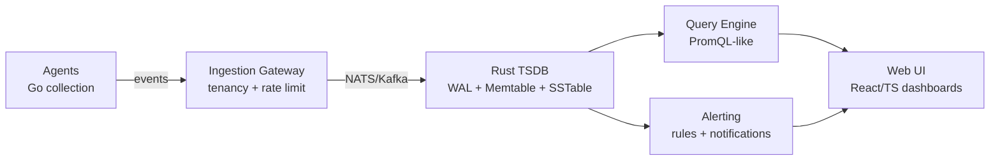

<p align="center">
  
</p>

<h1 align="center">⚡ cokovali10-sketch</h1>

<p align="center">
  <b>Software Engineer · AI / LLM · Cybersecurity · Full-Stack · Minecraft Tooling</b><br/>
  <sub>I design and ship production-grade systems: multi-agent AI, SOC observability, XDR/SOAR, token optimization, Minecraft tooling.</sub>
</p>

<p align="center">
  <a href="https://github.com/cokovali10-sketch?tab=repositories"></a>
  <a href="https://github.com/cokovali10-sketch?tab=followers"></a>
  
  
</p>

<p align="center">
  
  
</p>

<p align="center">
  
</p>

---

## 🚀 Flagship Project — Helix Observatory

> **The most ambitious project in my portfolio.** A full SOC (Security Operations Center)
> observability platform built from scratch — a custom time-series database that
> replaces ClickHouse / Prometheus, with a Go ingestion layer, a Rust storage engine,
> a TypeScript web UI and Kubernetes deployment. ~34 000 lines of code.

<p align="center">
  <a href="https://github.com/cokovali10-sketch/helix">
    
  </a>
  
  
  
</p>

### What Helix does



### Components (scale)

| Component | Language | Lines | What it does |
|---|---|---|---|
| 🦀 Rust Storage Engine | Rust | ~12 000 | WAL, memtable, SSTable, compression, bloom filters |
| 🐹 Go SDK | Go | ~7 000 | Client library for the platform |
| 📘 TypeScript SDK | TS | ~5 500 | Browser/Node client |
| 🌐 Web UI | TS/React | ~6 400 | Dashboards, query builder, alerting views |
| 📡 Ingestion Gateway | Go | ~3 000 | Tenancy, per-tenant rate limits, NATS streaming |
| 🤖 Event Agent | Go | ~2 000 | Collection with backpressure + plugin pipeline |
| 🛠️ CLI | Go | ~2 200 | Command-line tooling |
| 📜 API Definitions | Go | ~4 800 | gRPC + REST |
| ☸️ Helm Charts | YAML | ~16 700 | Kubernetes deployment |
| 📊 Benchmarks | Rust | — | Criterion perf suites |

### Why it matters

- **Replaces ClickHouse + Prometheus** with a purpose-built TSDB tuned for SOC workloads.
- **Multi-tenant from day one** — per-tenant quotas, isolation, metadata.
- **Plugin architecture** for agents (health check → metrics extraction → tenant assignment).
- **Backpressure + token-bucket rate limiting** to survive bursts.
- **Full stack**: collection → ingestion → storage → query → alerting → UI → deploy.

> Helix is the largest and most scalable thing I've built. It is in active
> development (early alpha) — architecture is solid, implementation gaps are
> documented honestly in the repo.

---

## 🛠️ What I Build

| Field | What I do |
|---|---|
| 🤖 **AI / LLM** | Multi-agent orchestration, MCP servers, RAG, token optimization, LLM scrapers |
| 🛡️ **Security** | XDR/SOAR platforms, eBPF tracing, honeypots, API fuzzing, threat detection |
| ⛏️ **Minecraft** | World scanning, region-file analysis, performance modding |
| 🌐 **Web / Full-stack** | Compose Multiplatform, FastAPI, WebGL/3D UIs, bots, dashboards |

---

## 🔥 Highlighted Projects

<table>
  <tr>
    <td align="center" width="200">
      <b>☀️ SOLAR</b><br/>
      <small>Python</small><br/>
      <a href="https://github.com/cokovali10-sketch/solar"></a><br/>
      <sub>Token optimization layer: compression, context, semantic cache, routing, budgets. 45 tests.</sub>
    </td>
    <td align="center" width="200">
      <b>🛡️ Qorvex</b><br/>
      <small>Go + Rust</small><br/>
      <a href="https://github.com/cokovali10-sketch/qorvex"></a><br/>
      <sub>AI code verification platform: SAST/DAST/SBOM, policy engine, Rust sandbox (setrlimit + Job Objects).</sub>
    </td>
    <td align="center" width="200">
      <b>⚔️ ApexGuard</b><br/>
      <small>Go</small><br/>
      <a href="https://github.com/cokovali10-sketch/ApexGuard"></a><br/>
      <sub>Autonomous enterprise defense cluster with eBPF + AI deception.</sub>
    </td>
    <td align="center" width="200">
      <b>🕸️ AgentMesh</b><br/>
      <small>Python</small><br/>
      <a href="https://github.com/cokovali10-sketch/AgentMesh"></a><br/>
      <sub>Multi-agent AI orchestration: planner, router, layered memory, MCP.</sub>
    </td>
  </tr>
  <tr>
    <td align="center" width="200">
      <b>🛡️ AegisX</b><br/>
      <small>Python</small><br/>
      <a href="https://github.com/cokovali10-sketch/AegisX-"></a><br/>
      <sub>Autonomous XDR/SOAR: honeypots, eBPF, AI threat scoring.</sub>
    </td>
    <td align="center" width="200">
      <b>📄 GlassParse AI</b><br/>
      <small>Go</small><br/>
      <a href="https://github.com/cokovali10-sketch/glassparse-ai"></a><br/>
      <sub>LLM-ready HTML → JSON/Markdown/embeddings scraper.</sub>
    </td>
    <td align="center" width="200">
      <b>⛏️ WorldScanner</b><br/>
      <small>Kotlin</small><br/>
      <a href="https://github.com/cokovali10-sketch/WorldScanner"></a><br/>
      <sub>Minecraft region-file scanner: blocks, items, entities → JSON/CSV.</sub>
    </td>
    <td align="center" width="200">
      <b>🃏 MockPulse</b><br/>
      <small>Go/Kotlin</small><br/>
      <a href="https://github.com/cokovali10-sketch/Mockpulse"></a><br/>
      <sub>Zero-config OpenAPI mock server with Lua scripting & chaos.</sub>
    </td>
  </tr>
  <tr>
    <td align="center" width="200">
      <b>🧠 flashcard-mcp</b><br/>
      <small>Python</small><br/>
      <a href="https://github.com/cokovali10-sketch/flashcard-mcp"></a><br/>
      <sub>SM-2 spaced-repetition memory server for any AI assistant.</sub>
    </td>
    <td align="center" width="200">
      <b>☕ caffeine-glass-ui</b><br/>
      <small>HTML/JS</small><br/>
      <a href="https://github.com/cokovali10-sketch/caffeine-glass-ui"></a><br/>
      <sub>Luxury 3D WebGL + Glassmorphism one-page experience.</sub>
    </td>
    <td align="center" width="200">
      <b>🧰 SecureFlow</b><br/>
      <small>Go</small><br/>
      <a href="https://github.com/cokovali10-sketch/SecureFlow"></a><br/>
      <sub>Security-focused workflow tooling.</sub>
    </td>
    <td align="center" width="200">
      <b>📦 +20 more</b><br/>
      <small>various</small><br/>
      <a href="https://github.com/cokovali10-sketch?tab=repositories"></a><br/>
      <sub>Security, bots, Minecraft, web, CLI tools.</sub>
    </td>
  </tr>
</table>

> 📂 Full list: [all repositories](https://github.com/cokovali10-sketch?tab=repositories)

---

## 🧰 Tech Stack

```text
Languages     Python · Go · Rust · Java · Kotlin · TypeScript · JavaScript · HTML/CSS
AI / LLM      OpenAI API · Anthropic Claude · MCP · RAG · Vector embeddings · Token optimization
Frameworks    FastAPI · Compose Multiplatform · aiogram · JDA · Typer · React · gRPC
Security      eBPF · Wireshark · Honeypots · API fuzzing · Threat intelligence · XDR/SOAR
Infra         Git/GitHub Actions · Docker · Kubernetes/Helm · SQLite · NATS · WebSockets · REST
Storage       Custom TSDB · WAL · Memtable · SSTable · Bloom filters · Compression
```

---

## 📊 GitHub Stats

<p align="center">
  
</p>

<p align="center">
  
</p>

---

## 🧭 Philosophy

> **Build real things. Measure honestly. Document the gaps.**
>
> I'd rather ship a working MVP with documented limitations than a glossy demo.
> Every project in this profile has an honest assessment of what works and what doesn't.

---

## 📬 Contact

<p align="center">
  <a href="https://github.com/cokovali10-sketch"></a>
</p>

<p align="center">
  <i>Always learning · Always building · Quality over quantity</i>
</p>
